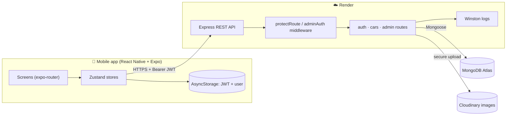
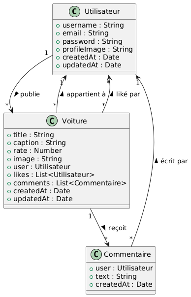
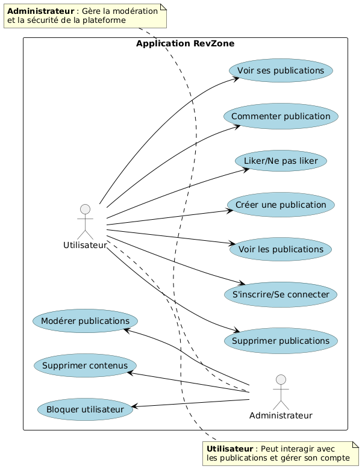
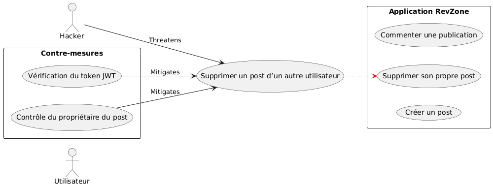
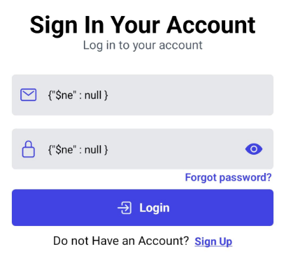
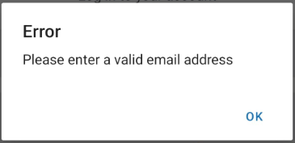
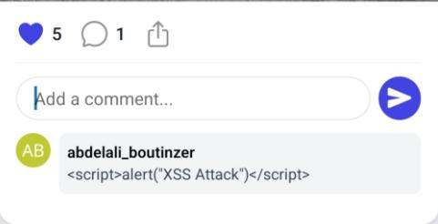
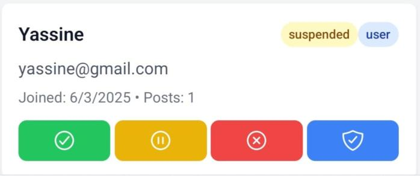
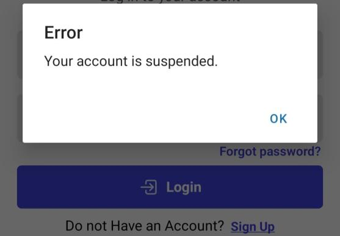
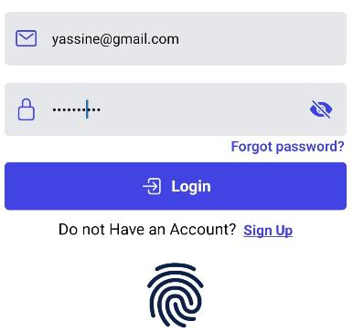

<div align="center">


# RevZone

**A secure social network for car enthusiasts: share your cars, rate them, like and comment.**

Built with React Native (Expo), Node.js/Express and MongoDB, with security designed in from the start
(STRIDE threat modeling, JWT auth, role-based access control, injection and XSS testing).


[Screenshots](#-screenshots) · [Features](#-features) · [Architecture](#-architecture) · [Security](#-security) · [Getting started](#-getting-started)

</div>

---

## 📌 About

RevZone is a mobile app where car enthusiasts post their cars with a photo, a description and a rating out of 5.
Other members can browse the feed, like posts and leave comments. Administrators moderate the community from
an in-app dashboard: they can suspend, ban or promote users and remove inappropriate content.

The project was built for the **Advanced Web & Mobile Application Security** module of the
*Master of Excellence in Data Science & Information Systems Security* (Faculté Polydisciplinaire de Beni Mellal,
Sultan Moulay Slimane University, 2024–2025). Security was a requirement from day one: the app went through threat
modeling (STRIDE, trust levels, entry points, critical assets, misuse cases), manual vulnerability testing, and
hardening on both the client and the server.

| Repository | Content |
|---|---|
| **REVZONE_MOBILE** (this repo) | React Native / Expo mobile client |
| [REVZONE_BACKEND](https://github.com/adnane-amrs/REVZONE_BACKEND) | Node.js / Express REST API |

---

## 📱 Screenshots

| Welcome | Login | Register |
|:---:|:---:|:---:|
|  |  |  |

| Feed | Comments | Create a post |
|:---:|:---:|:---:|
|  |  |  |

| Profile | Admin dashboard | User management |
|:---:|:---:|:---:|
|  |  |  |

---

## ✨ Features

### For members
- **Sign up / log in** with email and password, with client-side and server-side validation
- **Fingerprint login** using the device's biometric sensor
- **Feed** of all posts, newest first, with infinite scroll and pull-to-refresh
- **Create a post**: title, description, 1–5 star rating and a photo taken with the camera or picked from the gallery
- **Like / unlike** and **comment** on any post
- **Profile** with your own posts, where you can **edit** or **delete** them

### For administrators
- **Dashboard** with live stats: total, active, suspended and banned users, new users this week, total and new posts
- **User management**: search, filter by status or role, **activate / suspend / ban** accounts, change roles
- **Post moderation**: search posts by title and delete inappropriate content
- **Role-based navigation**: admins are routed to the admin area, and regular users can't open it

---

## 🏗 Architecture



| Layer | Technologies |
|---|---|
| Mobile | React Native 0.79, Expo SDK 53, expo-router (file-based navigation), NativeWind (Tailwind CSS), Zustand |
| Device APIs | expo-image-picker (camera/gallery), expo-local-authentication (biometrics), expo-screen-capture |
| Backend | Node.js, Express 5, Mongoose, JSON Web Tokens, bcryptjs, Winston |
| Data & media | MongoDB Atlas, Cloudinary |
| Hosting | Render (API served over HTTPS) |

### Data model

<p align="center"></p>

- **User**: username, email, hashed password, avatar, `role` (`user` / `moderator` / `admin`), `status` (`active` / `suspended` / `banned`), suspension date and reason
- **Car** (a post): title, caption, image URL, rating (1–5), author, list of likes, embedded comments
- **Comment** (sub-document): author, text, timestamps

<details>
<summary><b>Use case diagram</b></summary>
<p align="center"></p>
</details>

### REST API

| Method | Endpoint | Access | Description |
|---|---|---|---|
| `POST` | `/api/auth/register` | Public | Create an account |
| `POST` | `/api/auth/login` | Public | Log in and receive a JWT |
| `GET` | `/api/cars?page=&limit=` | User | Paginated feed |
| `POST` | `/api/cars` | User | Create a post (image uploaded to Cloudinary) |
| `GET` | `/api/cars/user` | User | My posts |
| `PUT` | `/api/cars/:id` | Owner | Edit a post |
| `DELETE` | `/api/cars/:id` | Owner | Delete a post |
| `POST` | `/api/cars/:id/like` | User | Like / unlike |
| `GET` · `POST` | `/api/cars/:id/comments` · `/comment` | User | Read / add comments |
| `GET` | `/api/admin/users` · `/users/stats` | Admin | List / stats of users (search, filters, pagination) |
| `PATCH` | `/api/admin/users/:id/status` · `/role` | Admin | Suspend, ban, activate, change role |
| `POST` | `/api/admin/users/bulk` | Admin | Bulk actions on users |
| `GET` · `DELETE` | `/api/admin/posts` · `/posts/:id` | Admin | Moderate posts |

---

## 🔐 Security

### Threat modeling
The app was analyzed with **STRIDE** before hardening: trust levels (anonymous, authenticated user, admin, API,
database, mobile client), external dependencies, entry points, critical assets (user data, JWTs, roles, server
secrets) and a **misuse case** for the most sensitive action, deleting another user's post.

<p align="center"></p>

| STRIDE threat | Mitigation in RevZone |
|---|---|
| **S**poofing: forged token | JWTs signed with a server secret and verified on every protected request |
| **T**ampering: editing someone else's post | Server checks that the requester owns the post before an update or delete |
| **R**epudiation | `createdAt` / `updatedAt` on every document, plus Winston activity and error logs (IP, user, action) |
| **I**nformation disclosure | Passwords never returned (`select("-password")`), all traffic over HTTPS, protected routes only |
| **D**enial of service | Input size limits (5 MB images, max text lengths), comment spam filter |
| **E**levation of privilege | Separate `adminAuth` middleware (role **and** account status), roles can't be changed from the client, admins can't change their own role or status |

### What is implemented

**Authentication & sessions**
- Stateless **JWT** authentication (15-day expiry), sent as `Authorization: Bearer <token>`
- `protectRoute` middleware verifies the token and loads the user without the password field
- `adminAuth` middleware also requires `role === "admin"` and an `active` account
- **Suspended and banned accounts are blocked at login**, with the reason and end date of the suspension

**Data protection**
- Passwords hashed with **bcrypt, 12 salt rounds**, in a Mongoose `pre("save")` hook
- All traffic goes over **HTTPS**, and images are stored on Cloudinary and served through `secure_url`
- Secrets (`JWT_SECRET`, `MONGO_URI`, Cloudinary keys) are kept in environment variables and never committed

**Input validation (server side, mirrored on the client)**
- Strict email regex, strong password (8+ characters, at least one letter and one digit), username ≥ 3 characters, password confirmation
- Post title 3–100 characters, description 10–1000, rating a number from 1 to 5
- Comments 2–500 characters, with a filter that rejects spam made of repeated characters
- Images must be a `data:image/` payload of **5 MB or less**

**Mobile-specific protections**
- **Biometric login** with expo-local-authentication, falling back to the device passcode
- **Screenshots and screen recording are blocked** on the profile and admin dashboard screens (expo-screen-capture)
- **Runtime permissions**: camera and gallery access is requested only when the user picks a photo, never at launch
- **Route guard** in the root layout redirects users based on their auth state and role

**Logging & monitoring**
- Winston logs split into `activity.log`, `error.log` and `combined.log`, rotated at 5 MB with 5 files kept
- HTTP request logging (method, URL, status, duration, IP, user agent) and logs of failed logins
- A log analysis CLI: `npm run logs:summary | logs:stats | logs:errors | logs:search`

### Penetration tests

| Test | Result |
|---|---|
| **NoSQL injection** on login: `{"$ne": null}` in the email and password fields | Rejected by validation, no authentication bypass |
| **Stored XSS**: `<script>alert("XSS Attack")</script>` in comments and descriptions | Displayed as plain text, nothing executes |
| **Access control**: a suspended user tries to log in | `403 Your account is suspended.` |

| NoSQL injection attempt | Blocked | XSS payload stored as plain text |
|:---:|:---:|:---:|
|  |  |  |

| Admin suspends a user | Suspended user can't log in | Biometric login |
|:---:|:---:|:---:|
|  |  |  |

### Security roadmap
Improvements identified during the review, planned for the next iteration:
- Move the JWT and biometric credentials from AsyncStorage to **expo-secure-store** (Keychain / Keystore)
- Wire **express-rate-limit** (already a dependency) onto the `/auth` routes to slow down brute-force attempts
- Return a single generic message for "unknown email" and "wrong password" to prevent account enumeration
- Add short-lived access tokens with refresh tokens

---

## 🚀 Getting started

### Prerequisites
- Node.js 18+
- The [Expo Go](https://expo.dev/go) app on your phone, or an Android / iOS emulator
- A MongoDB Atlas cluster and a Cloudinary account (for the backend)

### 1. Backend
```bash
git clone https://github.com/adnane-amrs/REVZONE_BACKEND.git
cd REVZONE_BACKEND
npm install
```
Create a `.env` file:
```env
PORT=3000
MONGO_URI=mongodb+srv://<user>:<password>@<cluster>/revzone
JWT_SECRET=<a-long-random-string>
CLOUDINARY_CLOUD_NAME=<cloud-name>
CLOUDINARY_API_KEY=<api-key>
CLOUDINARY_API_SECRET=<api-secret>
```
```bash
npm run dev
```

### 2. Mobile app
```bash
git clone https://github.com/adnane-amrs/REVZONE_MOBILE.git
cd REVZONE_MOBILE
npm install
```
Point the app to your API in `constants/api.js`:
```js
export const API_URL = 'https://<your-backend-host>/api';
```
```bash
npx expo start
```
Scan the QR code with Expo Go, or press `a` for Android or `i` for iOS.

> To get an admin account, register normally, then set `role: "admin"` on that user in MongoDB.

---

## 📂 Project structure

```
app/
├── index.jsx            # Welcome screen
├── _layout.jsx          # Root stack + auth / role route guard
├── (auth)/              # Login, Register
├── (tabs)/              # Feed, Create, Profile, Edit (bottom tabs)
└── (admin)/             # Dashboard, Users, Posts (admin only)
components/              # ProfileHeader, Loader, SafeScreen, Spacer
store/                   # Zustand stores: authStore, adminStore
constants/               # API URL, color palette
lib/                     # Date helpers
docs/                    # Screenshots, UML diagrams, security test captures
```

---

## 👥 Team

Built by **Adnane Amrouss**, **Abdelkhalek Essaid**, **Khalid Maghfour** and **Abdelali Boutinzer**,
supervised by **Pr. M. Fariss**, as part of the *Master of Excellence in Data Science & Information Systems Security*,
Faculté Polydisciplinaire de Beni Mellal, 2024–2025.
