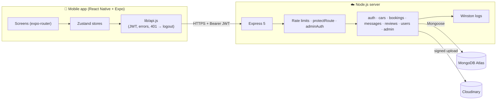
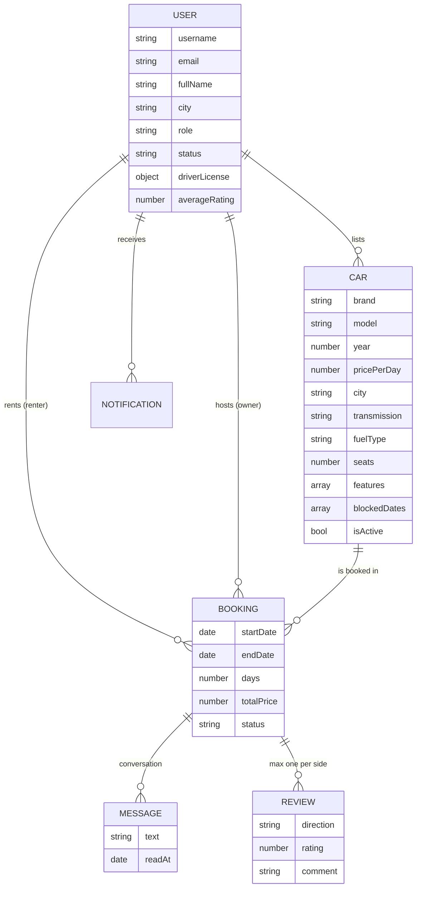

<div align="center">


# RevZone

**Peer-to-peer car rental for Morocco: rent a car from a local owner, or earn money by sharing yours.**

React Native (Expo) · Node.js / Express · MongoDB, with security designed in from the start:
threat modeling, JWT auth, role-based access control and server-side business rules.


[Features](#-features) · [Design](#-design) · [Architecture](#-architecture) · [Security](#-security) · [Getting started](#-getting-started)

</div>

---

## 📌 About

RevZone works like "Airbnb for cars". Car owners list their cars with photos, a daily price and the days they're
available. Renters search by city and dates, send a booking request, chat with the owner and review the trip afterwards.

The app has **two sides**, and anyone can use both:

| 🚗 Renter mode | 🔑 Owner mode |
|---|---|
| Browse and search cars | List cars (photos, price, specs, features) |
| Send booking requests | Choose the days the car is available |
| Chat with the owner | Accept or decline booking requests |
| Follow trips: upcoming, on trip, past | Hosting dashboard: earnings, requests, handovers |
| Review the car and its owner | Review the renter |

The project started in the **Advanced Web & Mobile Application Security** module of the
*Master of Excellence in Data Science & Information Systems Security* (Faculté Polydisciplinaire de Beni Mellal, 2024–2025)
as a social network for car enthusiasts. It was then rebuilt as a rental platform, keeping and extending the original
security work.

| Repository | Content |
|---|---|
| **REVZONE_MOBILE** (this repo) | React Native / Expo app |
| [REVZONE_BACKEND](https://github.com/adnane-amrs/REVZONE_BACKEND) | Node.js / Express REST API |

## 📱 Screenshots

Screenshots of the new design are being added. The list of screens is in [docs/screenshots](docs/screenshots).

---

## ✨ Features

### Renter
- **Explore** with search by city and trip dates (cars already booked or blocked on those days are hidden)
- **Filters**: price range, gearbox, fuel type, seats, brand; **sorting** by price, rating or newest; one-tap quick filters
- **Car details**: swipeable photo gallery, specs, features, owner profile with rating, latest reviews
- **Booking**: calendar that greys out unavailable days, live price summary, optional message to the owner
- **Trips**: upcoming, on trip and past, with a status timeline (requested → confirmed → on trip → done)
- **Reviews** after a completed trip, with 1–5 bouncing stars

### Owner
- **"List your car"**: 4-step form (basics → specs & features → photos → price & description); photos upload as soon as they're picked
- **My cars**: edit, pause / resume, delete; badge with the number of pending requests
- **Availability calendar**: block days; days already booked by renters are locked
- **Requests**: accept or decline; accepting automatically declines other requests for the same days
- **Hosting dashboard**: earnings this month, requests waiting for an answer, upcoming handovers

### Both sides
- **Chat** per booking, with read receipts
- **In-app notifications**: new request, confirmation, cancellation, message, review, license decision
- **Profiles**: photo, bio, city, rating, trips, cars listed, reviews received
- **Driver license verification**: upload, then an admin approves or rejects it; approved users get a verified badge

### Admin
- Dashboard with user, listing and booking statistics
- Users: search, filters, activate / suspend / ban, change role
- Listings: hide / show, delete
- Driver license review queue

---

## 🎨 Design

The interface was designed specifically for this project: dark headers, white cards and a floating black tab bar, with a lime accent. It comes in a **light and a dark version** (Profile → Appearance: System, Light or Dark; the choice is remembered). Lime fills buttons, pills and badges in both versions, always with black text on it.

| Token | Light | Dark | Used for |
|---|---|---|---|
| Canvas / Paper | `#F0F0F2` / `#FFFFFF` | `#0E0E10` / `#1A1A1D` | Screen backgrounds, cards, panels |
| Accent (lime) | `#D4F34A` | `#D4F34A` | Buttons, active tab, selections, badges |
| Accent text | `#4F6B00` | `#D4F34A` | Small accent text and icons (prices, links) |
| Ink | `#0E0E10` | `#1F1F23` | Dark headers, tab bar, highlight cards |

All colors live in `constants/theme.js`; switching versions swaps the palette and re-mounts the screens.

- **Font**: Plus Jakarta Sans (SIL Open Font License, bundled in `assets/fonts`)
- **Components**: floating pill tab bar, round icon buttons, pill headers, bottom sheets, skeleton loaders, toasts. All built in `components/ui`; no UI library is used
- **Animations** (Reanimated 3): staggered list entrances, spring press feedback, sliding tab and segment indicators, parallax photo header, draggable bottom sheets, animated calendar months, renter ↔ owner mode transition
- **Generated avatars**: users without a photo get an avatar drawn on the phone (car paint colors, racing stripes, initials), so no username is sent to a third-party avatar service

---

## 🏗 Architecture



| Layer | Technologies |
|---|---|
| Mobile | React Native 0.79, Expo SDK 53, expo-router (file-based navigation), NativeWind, Zustand |
| UI & motion | Reanimated 3, Gesture Handler, expo-image, expo-linear-gradient, expo-haptics |
| Device APIs | expo-image-picker, expo-local-authentication (fingerprint), expo-screen-capture |
| Backend | Node.js, Express 5, Mongoose 8, jsonwebtoken, bcryptjs, express-rate-limit, Winston |
| Data & media | MongoDB Atlas, Cloudinary |

### Data model



**Booking lifecycle**: `pending → accepted → active → completed`, or `declined` / `cancelled`.
Statuses move forward by themselves when dates pass (checked whenever bookings are read, no cron job needed),
and a request that's still pending when its start day passes expires.

---

## 🔐 Security

### Threat model (STRIDE)

| Threat | Example in a rental app | Mitigation |
|---|---|---|
| **S**poofing | Forged token to act as another user | Signed JWTs verified on every request; account status re-checked on every request |
| **T**ampering | Paying less by sending a fake price | The **server computes the total** from its own price and dates; the client's total is ignored |
| **T**ampering | Booking days that are already taken | Overlap check against accepted bookings and blocked days, at request time **and** again at acceptance |
| **R**epudiation | "I never cancelled that booking" | `cancelledBy`, timestamps and Winston activity logs (user, IP, action) |
| **I**nformation disclosure | Reading someone else's booking or chat | Bookings and messages visible only to the renter and the owner (others get 404) |
| **I**nformation disclosure | Harvesting phone numbers | Phone shared only once a booking is confirmed; public profiles never include email or phone |
| **I**nformation disclosure | Leaking ID documents | Driver licenses stored as private Cloudinary assets, opened only through server-signed URLs for admins |
| **D**enial of service | Brute-force login, spam | Rate limits on auth (20 / 15 min), uploads and messages; request size limits |
| **E**levation of privilege | Making yourself admin or verified | Role, status and verification can't be changed through the profile API; admin routes check role **and** status |

### Implemented controls
- **Authentication**: JWT (Bearer), bcrypt with 12 salt rounds, strong password rules, fingerprint login
- **Sessions**: suspended or banned users lose access immediately, not when their token expires
- **No account enumeration**: the same "Invalid email or password" message for unknown emails and wrong passwords
- **Authorization**: ownership checks on listings, participant checks on bookings, chats and reviews; reviews only after a completed trip, once per side
- **Input validation**: every field validated server-side with types and lengths; query parameters forced to plain strings (blocks `?city[$ne]=` style NoSQL injection); search text escaped before being used in a regex (blocks ReDoS); sort options from a fixed list
- **Uploads**: only JPEG / PNG / WebP, 5 MB max, and listings only accept image URLs from the app's own Cloudinary account
- **Mobile**: screenshots and screen recording blocked on the driver license and admin screens; camera and gallery permission requested only when the user picks a photo; no secret in the app
- **Secrets**: kept in environment variables, never committed (`.env` and database backups are git-ignored)

### Tests
The backend repo has two runnable suites (`npm run test:api`, `npm run test:e2e`) with **64 checks**:
injection attempts, access control between users, price tampering, double booking, blocked days, review rules,
self-promotion, the full listing lifecycle with a real Cloudinary upload, and more.

### Known limitations
- Fingerprint login stores the email and password in AsyncStorage (not encrypted). Planned: expo-secure-store
- JWTs last 15 days, with no refresh tokens yet
- Chat refreshes every 4 seconds (polling), not real time over WebSockets
- No online payment; the price is agreed in the app and paid at pick-up

---

## 🚀 Getting started

### Prerequisites
- Node.js 18+
- [Expo Go for SDK 53](https://expo.dev/go) on an Android or iOS phone
- A MongoDB Atlas cluster and a Cloudinary account

### 1. Backend
```bash
git clone https://github.com/adnane-amrs/REVZONE_BACKEND.git
cd REVZONE_BACKEND
npm install
# create .env (see the backend README), then:
npm run migrate   # creates the demo accounts (and converts legacy data if any)
npm run dev
```

### 2. Mobile app
```bash
git clone https://github.com/adnane-amrs/REVZONE_MOBILE.git
cd REVZONE_MOBILE
npm install
npx expo start
```
Scan the QR code with Expo Go. Phone and computer must be on the same Wi-Fi.

In development the app finds the backend on its own: it uses the same computer address that Expo is served from,
on port 5000 ([constants/api.js](constants/api.js)). Production builds use the public API URL.

**Demo accounts** (created by `npm run migrate`, password `Demo1234`):
`demo.renter@revzone.app` and `demo.owner@revzone.app`. Switch between renter and owner mode in **Profile**.

---

## 📂 Project structure

```
app/
├── index.jsx                 # Welcome
├── _layout.jsx               # Fonts, providers, auth / role / mode route guard
├── (auth)/                   # Login, Register
├── (tabs)/                   # Renter: explore, trips · Owner: host, cars, requests · Both: inbox, profile
├── car/[id]/                 # Details, book, availability
├── listing/                  # New listing, edit listing
├── booking/[id].jsx          # Booking details and actions
├── chat/[bookingId].jsx      # Conversation
├── review/[bookingId].jsx    # Leave a review
├── user/[id].jsx             # Public profile
├── profile/                  # Edit profile, driver license
└── (admin)/                  # Dashboard, users, listings, licenses
components/
├── ui/                       # Design system: buttons, inputs, tab bar, sheets, skeletons…
├── cars/                     # Car card, gallery, listing form, search & filter sheets
└── booking/                  # Calendar, booking card, trips / requests screen
store/                        # Zustand: auth, mode (renter/owner), search, badges, admin, toasts
lib/                          # API client, dates, image picking & upload
constants/                    # Theme tokens, labels, API URL
```

---

## 👥 Team

Built by **Adnane Amrouss**, **Abdelkhalek Essaid**, **Khalid Maghfour** and **Abdelali Boutinzer**,
supervised by **Pr. M. Fariss**, as part of the *Master of Excellence in Data Science & Information Systems Security*,
Faculté Polydisciplinaire de Beni Mellal, 2024–2025.

Font: [Plus Jakarta Sans](https://github.com/tokotype/PlusJakartaSans) (SIL Open Font License 1.1) · Icons: Ionicons
